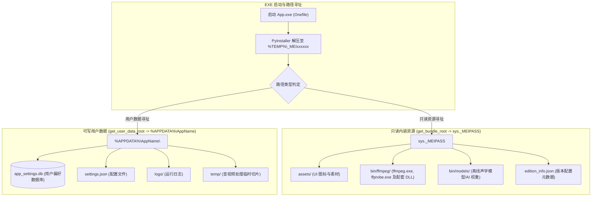

# 🤖 SKILL: Python EXE 打包构建标准流程

## 🎯 核心目标
指导 Agent 如何为 Python 应用程序（特别是 GUI 桌面应用及结合 AI / C++ / 媒体库的复杂应用）构建标准化、工业级、高度自包含的 `.exe` 打包流程。该流程基于 PyInstaller，采用 `PowerShell 脚本 + Python 打包脚本` 的双层架构，以确保跨平台开发体验的流畅性、依赖收集的完整性、构建过程的高效剪枝瘦身以及故障避坑的自动化。

**【核心硬约束·全量适配 Windows Sandbox 纯净环境】**：
流程全面确立了 **`--onefile` 单文件自解压打包规范**，确保生成的独立 `.exe` 可直接复制到**纯净、脱机、无 Python、无 FFmpeg、未安装任何额外 VC++ 运行库的 Windows Sandbox（Windows 沙盒）**环境中双击即开即用；同时强制推行**“只读解压资源与可写用户数据双轨路径隔离（严禁污染桌面与 exe 目录）”**、外置工具/VC++ 运行时库自包含内嵌、单例运行守护、专属 7 级图标资产以及**业务数据统一采用本地嵌入式 SQLite 数据库持久化（严禁散落伴生文件）**的交付闭环规范。

---

## 🧩 标准架构设计
一个高复用性、标准的 Python 项目打包架构应包含以下核心组件：
1. **`build.ps1` & `build.bat`**: 顶层自动化构建与双击启动器。负责环境准备、依赖安装、历史产物清理、参数穿透并触发 Python 打包，提供彩色状态反馈。
2. **`build.py`**: 核心 `--onefile` 打包配置脚本。通过调用 `PyInstaller.__main__.run()`，包含进程终止与延迟释放、历史 onedir 产物清理、外置工具套件自动内嵌、VC++ 核心运行库注入、离线模型校验、模块剪枝排除、源码路径注入等高级配置。
3. **`requirements.txt`**: 明确的项目依赖列表。
4. **`.gitignore`**: 忽略 `build/`, `dist/`, `*.spec` 等中间与目标构建产物。

---

## 🚀 Agent 执行工作流 (SOP)

当面临“为这个 Python 项目打包成 exe”、“配置构建过程”或类似需求时，Agent 应严格遵循以下步骤：

### Step 1: 分析项目结构与依赖环境
1. **入口与源码路径**：
   - 识别主入口文件（如 `src/main.py` 或 `app.py`）。
   - 若项目采用 `src/` 目录架构且存在 `from src.xxx import yyy` 导入，打包时必须配置 `'--paths=.'`（将项目根目录加入 Python 模块检索路径）。
2. **交互类型与单文件模式（Windows Sandbox 核心红线）**：
   - **GUI 桌面应用（强制 `--onefile` 单文件自解压）**：
     - 使用 `'--windowed'`（隐藏控制台窗口）配合 `'--onefile'`（单文件自解压可执行程序）。
     - **为何严禁在沙盒分发中使用 `'--onedir'` 散装目录**：`--onedir` 生成带有大量伴生文件和 `_internal` 依赖子目录的文件夹。用户在 Windows Sandbox 中分发测试时，习惯将单个 exe 复制到沙盒桌面直接运行，缺失同级 `_internal` 目录时会直接报错 `python38.dll` 或核心模块找不到；同时散装目录结构无法实现单文件即拷即用。
   - **CLI 命令行工具**：
     - 不加 `'--windowed'`，保留控制台，同样推荐 `'--onefile'` 方便便携分发。
3. **剪枝与瘦身排除 (`--exclude-module`)**：
   - 检查项目使用的 UI 框架（PySide6, PyQt, Tkinter, CustomTkinter）或大型库（matplotlib, torch, pandas）。
   - 显式排除未使用的臃肿子模块（如 `QtWebEngineCore`, `Qt3DCore`, `QtQml`, `QtQuick`, `QtDesigner`, `QtPdf`, `matplotlib`, `tkinter` 等），单文件体积可减少上百兆，构建速度提升 5~10 倍。
4. **特殊原生/AI 依赖收集 (`--collect-all`)**：
   - 含有 C++ 动态库 (`.dll`/`.so`)、模型配置文件或 JSON 分词器的依赖包（如 `faster_whisper`, `ctranslate2`, `tokenizers`, `onnxruntime`, `customtkinter`, `cv2`），必须使用 `'--collect-all', 'package_name'`。
5. **外置可执行套件自包含内嵌规范 (FFmpeg / CLI 工具)**：
   - **核心转变与痛点根除**：**严禁假设宿主机或沙盒环境中已配置系统 PATH，严禁依赖运行时联网下载，严禁要求在 exe 同级手动放置伴生 `bin/` 文件夹**！
   - Windows Sandbox 是无网络、无外部预装工具的纯净环境。打包脚本必须实现**自动化外部工具探测与内嵌**：
     - 自动探测项目 `bin/ffmpeg` 或宿主机 PATH 中的 `ffmpeg.exe` 与 `ffprobe.exe` 及其同级配套动态链接库（`avcodec-*.dll`、`avformat-*.dll` 等，排除无需使用的 `ffplay.exe` 以减重）；
     - 通过 `--add-data` 统一打包内嵌至单文件内部虚拟路径（如 `bin/ffmpeg`）；
     - 代码寻址时按优先级解析：1. 包内解压目录 `sys._MEIPASS`；2. 用户数据目录；3. 系统 PATH。彻底消除纯净环境启动弹窗报错。
6. **纯净环境 VC++ 核心运行库兜底注入 (VC++ Runtime Fallback)**：
   - **痛点**：纯净 Windows Sandbox 镜像可能未安装 Visual C++ 2015-2022 Redistributable，导致底层 C/C++ 扩展或调用崩溃。
   - **硬性约束**：构建脚本必须自动从当前 Python 解释器目录（`os.path.dirname(sys.executable)`）或 `C:\Windows\System32` 检索核心 VC++ 运行库 DLL：
     `vcruntime140.dll`, `vcruntime140_1.dll`, `msvcp140.dll`, `msvcp140_1.dll`, `msvcp140_2.dll`, `msvcp140_atomic_wait.dll`, `msvcp140_codecvt_ids.dll` 等。
     并通过 `--add-data=xxx;.` 注入至单文件内部根目录，确保纯净沙盒环境底层 C/C++ 模块正常加载。
7. **双轨路径隔离机制与桌面零污染 (Path Dual-Track Design)**：
   - **痛点**：用户将单文件 exe 复制到 Windows Sandbox 桌面直接运行，若程序直接在 exe 所在目录创建日志、数据库、切片缓存，会导致沙盒桌面被严重污染；同时若误写入 `sys._MEIPASS`，程序退出后数据丢失且存在只读权限报错。
   - **硬性约束**：严格执行双轨路径设计：
     - **只读内嵌资源**：走 `get_bundle_root()` $\to$ `sys._MEIPASS`（UI素材、内置工具、离线模型等）；
     - **可写用户数据**：走 `get_user_data_root()` $\to$ `%APPDATA%/<AppName>/`（数据库、日志、配置、切片缓存）；若沙盒受限环境缺失 `%APPDATA%` 环境变量，自动优雅回退至用户 Home 目录 `~/.<app_name>`；
     - **严禁**在 `get_app_root()`（exe 所在目录，如桌面）自动执行 `mkdir` 或创建任何文件。
8. **子进程安全调用与无控制台黑框**：
   - GUI 应用在后台调用内嵌的 `ffmpeg` 或 AI 代理子进程时：
     - 必须使用绝对路径定位 `sys._MEIPASS` 下的可执行文件；
     - **必须显式设置子进程的 `cwd` 为该可执行文件所在目录**，确保 Windows 动态链接器优先命中同级依赖 DLL；
     - 必须传入 `creationflags=subprocess.CREATE_NO_WINDOW` 避免弹出黑色 CMD 窗口；
     - 参数必须使用列表传递，严禁拼接裸字符串。
9. **GUI 应用单例运行与防多开保护 (Single Instance Guard)**：
   - 桌面 GUI 程序冷启动加载 Qt、动态链接库与 AI 权重耗时约 1~2 秒，用户双击、微动连击或连按时极易产生多个重复进程与主窗口。
   - **硬性约束**：所有面向用户的 GUI 桌面应用入口必须集成**毫秒级内核互斥判定**与**已有窗口置顶唤醒**机制，次级实例必须静默退出；同时主入口必须调用 `multiprocessing.freeze_support()` 防范子进程重入。
10. **应用专属图标与视觉资产规范 (Application Icon Requirement)**：
    - **硬性约束**：所有面向用户的 GUI 桌面应用必须配备匹配其业务功能的专属定制图标，严禁发布裸奔使用 PyInstaller 默认软盘/羽毛图标的 EXE 产物。
    - 图标必须使用 Windows PE 标准的 7 级多分辨率 `app.ico`（`16x16` 至 `256x256`），并在任务栏中注入 Win32 `AppUserModelID`，确保系统桌面、任务栏与窗口标题栏均能高保真呈现。
11. **业务数据持久化与数据库存储硬约束 (Database Storage Requirement)**：
    - **痛点根除**：严禁采用在媒体/音视频或工作目录下散落同名伴生文本文件（如 `clip.txt`, `clip.json`）的旧模式。此类模式不仅导致用户文件目录极度臃肿混乱，且无法实现多语言隔离、结构化检索与原子并发写入。
    - **硬性约束**：所有面向用户交互、AI 听写转写、用户笔记、学习记录等业务数据的持久化，**一律强制采用 Python 原生内置 `sqlite3` 本地数据库引擎**。
    - **零外部服务依赖**：`sqlite3` 作为 Python 标准库内置模块，单文件便携存储，无需安装任何外部数据库服务软件，天然适配 PyInstaller 桌面打包，零额外系统依赖。
    - **路径与并发标准**：统一存放在用户数据目录下的全英文专属子目录（如 `<user_data_root>/db/transcripts.db` 或 `<work_dir>/db/transcripts.db`），必须配置 `PRAGMA journal_mode=WAL;` 提升抗崩溃并发性能，并采用原子 Upsert 机制。

---

### Step 2: 生成/更新打包配置脚本 (`build.py`)

**标准工业级 `--onefile` 打包模板**:
```python
"""
PyInstaller 单文件自解压打包脚本
遵循 python-exe-build 规范，全量适配纯净 Windows Sandbox 环境
"""
import os
import sys
import time
import json
import shutil
import subprocess
import PyInstaller.__main__

# 解决 Windows 控制台输出编码问题
if sys.platform == "win32":
    try:
        sys.stdout.reconfigure(encoding="utf-8", errors="replace")
        sys.stderr.reconfigure(encoding="utf-8", errors="replace")
    except Exception:
        pass

APP_NAME = "YourAppName"
BASE_DIR = os.path.dirname(os.path.abspath(__file__))
if BASE_DIR not in sys.path:
    sys.path.insert(0, BASE_DIR)


def collect_ffmpeg_binaries() -> list:
    """自动探测并收集 ffmpeg.exe, ffprobe.exe 及其配套 DLL (排除 ffplay 以瘦身)"""
    candidates = [
        os.path.join(BASE_DIR, "bin", "ffmpeg"),
        os.path.join(BASE_DIR, "bin"),
    ]
    sys_ffmpeg = shutil.which("ffmpeg")
    if sys_ffmpeg:
        candidates.append(os.path.dirname(sys_ffmpeg))

    for c_dir in candidates:
        ff = os.path.join(c_dir, "ffmpeg.exe")
        fp = os.path.join(c_dir, "ffprobe.exe")
        if os.path.exists(ff) and os.path.exists(fp):
            files = []
            for item in os.listdir(c_dir):
                if item.lower() == "ffplay.exe":
                    continue  # 排除无需的播放器组件，节约体积
                full_p = os.path.join(c_dir, item)
                if os.path.isfile(full_p):
                    files.append(full_p)
            return files
    return []


def collect_vc_runtime_dlls() -> list:
    """自动收集 VC++ 核心运行时 DLL，确保在纯净无依赖的 Windows Sandbox 中稳定运行"""
    dll_names = [
        "vcruntime140.dll",
        "vcruntime140_1.dll",
        "msvcp140.dll",
        "msvcp140_1.dll",
        "msvcp140_2.dll",
        "msvcp140_atomic_wait.dll",
        "msvcp140_codecvt_ids.dll",
    ]
    search_dirs = [
        os.path.dirname(sys.executable),
        r"C:\Windows\System32",
    ]
    found = {}
    for d in search_dirs:
        if not os.path.exists(d):
            continue
        for name in dll_names:
            if name not in found:
                p = os.path.join(d, name)
                if os.path.isfile(p):
                    found[name] = p
    return list(found.values())


def main():
    target_exe_name = f"{APP_NAME}.exe"
    dist_dir = os.path.join(BASE_DIR, "dist")
    os.makedirs(dist_dir, exist_ok=True)
    target_exe_path = os.path.join(dist_dir, target_exe_name)

    # 1. 终止可能处于运行状态的旧进程，并在杀死后 sleep 等待操作系统释放句柄
    kill_targets = [target_exe_name, f"{APP_NAME}.exe", "ffmpeg.exe", "ffprobe.exe"]
    for proc in kill_targets:
        try:
            subprocess.run(["taskkill", "/F", "/IM", proc], stdout=subprocess.DEVNULL, stderr=subprocess.DEVNULL)
        except Exception:
            pass
    time.sleep(1.2)

    # 2. 清理旧版本单文件产物
    if os.path.exists(target_exe_path):
        try:
            os.remove(target_exe_path)
            print(f">>> 已清理旧版本单文件: {target_exe_path}")
        except Exception as e:
            print(f">>> [警告] 清理旧单文件失败: {e}")

    # 3. 清理历史 onedir 散装目录（防止用户混淆或拷错旧目录）
    legacy_dir = os.path.join(dist_dir, APP_NAME)
    if os.path.exists(legacy_dir):
        print(f">>> 正在清理历史 onedir 散装目录: {legacy_dir} ...")
        for _ in range(5):
            try:
                shutil.rmtree(legacy_dir)
                break
            except Exception:
                time.sleep(0.5)

    spec_file = os.path.join(BASE_DIR, f"{APP_NAME}.spec")
    if os.path.exists(spec_file):
        try:
            os.remove(spec_file)
        except Exception:
            pass

    # 4. 配置 PyInstaller 单文件打包参数
    options = [
        'src/main.py',              # 主入口文件
        f'--name={APP_NAME}',       # 生成的单文件 exe 名称
        '--windowed',               # GUI 应用隐藏控制台 (CLI 工具请删除此行)
        '--onefile',                # 单文件自解压模式 (Windows Sandbox 独立运行核心)
        '--clean',                  # 清理 PyInstaller 缓存
        '--noconfirm',              # 覆盖已有构建目录时不进行交互提示

        # --- 源码路径注入 (解决 'from src.xxx import yyy' 模块找不到问题) ---
        '--paths=.',

        # --- 静态资源与应用专属图标注入 ---
        '--icon=src/assets/app.ico',
        '--add-data=src/assets;assets',

        # --- 剪枝排除未使用的臃肿子模块 (提升构建速度 5~10 倍，极大缩减产物体积) ---
        '--exclude-module', 'PySide6.QtWebEngineCore',
        '--exclude-module', 'PySide6.QtWebEngineWidgets',
        '--exclude-module', 'PySide6.QtWebEngineQuick',
        '--exclude-module', 'PySide6.Qt3DCore',
        '--exclude-module', 'PySide6.Qt3DAnimation',
        '--exclude-module', 'PySide6.Qt3DExtras',
        '--exclude-module', 'PySide6.Qt3DInput',
        '--exclude-module', 'PySide6.Qt3DLogic',
        '--exclude-module', 'PySide6.Qt3DRender',
        '--exclude-module', 'PySide6.QtQml',
        '--exclude-module', 'PySide6.QtQuick',
        '--exclude-module', 'PySide6.QtQuickWidgets',
        '--exclude-module', 'PySide6.QtDesigner',
        '--exclude-module', 'PySide6.QtSql',  # 仅排除 Qt C++ SQL 插件；Python 原生内置 sqlite3 模块严禁排除
        '--exclude-module', 'PySide6.QtTest',
        '--exclude-module', 'PySide6.QtSensors',
        '--exclude-module', 'PySide6.QtSerialPort',
        '--exclude-module', 'PySide6.QtSpatialAudio',
        '--exclude-module', 'PySide6.QtPdf',
        '--exclude-module', 'PySide6.QtPdfWidgets',
        '--exclude-module', 'tkinter',
        '--exclude-module', 'matplotlib',
    ]

    # 5. 内嵌外置可执行工具 (如 FFmpeg 套件)
    ffmpeg_files = collect_ffmpeg_binaries()
    if ffmpeg_files:
        for f_path in ffmpeg_files:
            options.append(f'--add-data={f_path};bin/ffmpeg')
        print(f">>> [PRE-BUILD] 已自动收录内嵌 FFmpeg 套件 ({len(ffmpeg_files)} 个核心组件)")
    else:
        print(">>> [PRE-BUILD 警告] 未探测到 FFmpeg 运行套件！")

    # 6. 内嵌 VC++ 核心运行库 DLL (保障 Windows Sandbox 纯净环境可用性)
    vc_dlls = collect_vc_runtime_dlls()
    if vc_dlls:
        for dll_p in vc_dlls:
            options.append(f'--add-data={dll_p};.')
        print(f">>> [PRE-BUILD] 已自动纳入 VC++ 纯净环境兜底运行库 ({len(vc_dlls)} 个 DLL)")

    # 7. 执行 PyInstaller 打包
    print("\n>>> 开始调用 PyInstaller 进行单文件程序编译打包 (--onefile)...\n")
    PyInstaller.__main__.run(options)

    # 8. 清理临时 build 缓存与 spec 文件
    build_temp = os.path.join(BASE_DIR, "build")
    if os.path.exists(build_temp):
        for _ in range(3):
            try:
                shutil.rmtree(build_temp)
                break
            except Exception:
                time.sleep(0.5)

    if os.path.exists(spec_file):
        try:
            os.remove(spec_file)
        except Exception:
            pass

    # 9. 强制刷新 Windows 资源管理器图标缓存
    if sys.platform == "win32":
        try:
            import ctypes
            ctypes.windll.shell32.SHChangeNotify(0x08000000, 0x0000, None, None)
        except Exception:
            pass

    size_mb = 0
    if os.path.exists(target_exe_path):
        size_mb = os.path.getsize(target_exe_path) / (1024 * 1024)

    print("\n" + "=" * 62)
    print(f"[OK] 单文件构建完成！产物路径: {target_exe_path}")
    print(f"[SIZE] 单文件体积: {size_mb:.2f} MB")
    print(f"[ENV] 适配环境: 纯净 Windows Sandbox (单文件即开即用，零外部预装依赖)")
    print("=" * 62 + "\n")

    # 自动在资源管理器中高亮选中生成的 exe
    if sys.platform == "win32" and os.path.exists(target_exe_path):
        try:
            subprocess.Popen(['explorer', '/select,', os.path.normpath(target_exe_path)])
        except Exception:
            pass


if __name__ == "__main__":
    main()
```

---

### Step 3: 生成自动化构建脚本 (`build.ps1` & 双击启动器 `build.bat`)

**⚠️ PowerShell 与批处理脚本编写规范（防闪退核心红线）**:
1. **【强制】`param(...)` 声明必须置于文件除注释外的首行**:
   - 若脚本需要接收参数（如 `[string]$Edition = ""`），`param(...)` **必须是脚本最顶端的第一条语句**。严禁在 `param(...)` 之前执行任何命令（包括 `[Console]::OutputEncoding = ...` 或函数调用），否则 PowerShell 引擎在解析阶段直接报错 `The term 'param' is not recognized` 导致脚本秒退。
2. **【强制】控制台编码声明置于参数块之后**:
   - `[Console]::OutputEncoding = [System.Text.Encoding]::UTF8` 必须紧跟在 `param(...)` 块之后执行，确保终端输出中文字符不乱码。
3. **【强制】保存为 UTF-8 with BOM (`utf-8-sig`) 格式**:
   - Windows PowerShell 5.1 解析无 BOM 的 UTF-8 文件时，遇到中文或 Emoji 极易产生闭合花括号 `}` 的语法断句解析错误（报 `UnexpectedToken`）。修改或生成 `.ps1` 文件后，必须确保保存为带 BOM 签名的标准格式。
4. **【强制】路径动态定位**:
   - 脚本必须包含 `Set-Location -Path $PSScriptRoot`，确保无论在任何工作目录或终端调用均能正确以脚本所在目录为根路径执行。
5. **【强制】配套生成双击即用启动器 (`build.bat`)**:
   - Windows 操作系统对 `.ps1` 脚本默认受执行策略（Execution Policy，如 `Restricted`）限制，用户在资源管理器中直接双击 `.ps1` 会被系统拦截秒退。
   - **必须在同一目录下配套生成同名的 `build.bat` 批处理文件**，内部通过 `-ExecutionPolicy Bypass` 启动 `.ps1` 并支持参数穿透与错误暂停排查，保证用户双击即用、零门槛运行。

**标准 PowerShell 模板 (`build.ps1`)**:
```powershell
param(
    [string]$Edition = ""
)

[Console]::OutputEncoding = [System.Text.Encoding]::UTF8

# 切换到脚本所在目录，防止跨目录调用定位失败
Set-Location -Path $PSScriptRoot

Write-Host "=========================================" -ForegroundColor Cyan
Write-Host "       [应用名称] 自动化单文件构建脚本" -ForegroundColor Cyan
Write-Host "=========================================" -ForegroundColor Cyan
Write-Host ""

Write-Host "[1/3] 正在检查并安装必要的依赖..." -ForegroundColor Yellow
if (Test-Path "requirements.txt") {
    pip install -r requirements.txt
} else {
    Write-Host "未找到 requirements.txt，已跳过..." -ForegroundColor Yellow
}
pip install pyinstaller

Write-Host "`n[2/3] 正在清理历史构建产物与临时缓存..." -ForegroundColor Yellow
if (Test-Path "build") { Remove-Item -Recurse -Force "build" }
if (Test-Path "dist") { Remove-Item -Recurse -Force "dist" }
Get-ChildItem -Path . -Filter "*.spec" | Remove-Item -Force

Write-Host "`n[3/3] 正在执行 Python 单文件自解压打包流程..." -ForegroundColor Yellow
python build.py

if ($LASTEXITCODE -ne 0) {
    Write-Host "`n=========================================" -ForegroundColor Red
    Write-Host "❌ 打包失败！请检查上述日志排查错误。" -ForegroundColor Red
    Write-Host "=========================================" -ForegroundColor Red
} else {
    Write-Host "`n=========================================" -ForegroundColor Green
    Write-Host "✅ 单文件打包完成！独立运行程序位于 dist 目录。" -ForegroundColor Green
    Write-Host "=========================================" -ForegroundColor Green
}

Read-Host -Prompt "按 Enter 键退出"
```

**配套双击即用启动器模板 (`build.bat`)**:
```bat
@echo off
chcp 65001 >nul
title Application 打包构建

cd /d "%~dp0"
powershell -NoProfile -ExecutionPolicy Bypass -File "%~dp0build.ps1" %*
if errorlevel 1 (
    echo.
    echo 执行过程中发生错误！
    pause
)
```

---

### Step 4: 规范化 `.gitignore` 与环境建议
- **更新 `.gitignore`**：确保包含以下规则：
  ```gitignore
  build/
  dist/
  *.spec
  __pycache__/
  ```
- **虚拟环境建议**：强烈建议在独立的 `venv` 虚拟环境中执行打包，避免全局环境中安装的大量无关依赖库被 PyInstaller 误扫描打入包内。

---

### Step 5: 应用程序专属图标与全链路视觉资产落地 (Application Icon SOP)

为保证桌面 EXE、任务栏、窗口标题栏及快捷方式呈现专业级原生质感，严禁发布裸奔使用 PyInstaller 默认软盘/羽毛图标的 EXE，必须严格执行以下四位一体的图标资产流程：

1. **多尺寸 Windows `.ico` 生成与防浑浊标准**：
   - 必须提供 `src/assets/app.ico`（或项目约定图标目录 `icon/app.ico`），且**必须内嵌 7 级标准分辨率**：`16x16`, `24x24`, `32x32`, `48x48`, `64x64`, `128x128`, `256x256`（32-bit RGBA）；
   - 同时提供 `app.png`（512x512 或 1024x1024 无损高保真原图，用于 UI 高分辨率缩放与关于面板）；
   - **【深度教训·严禁图标发白与浑浊脏底】**：
     - **AI 原图外角伪白边清理**：现代 AI 绘图模型（如 Imagen、Midjourney 等）即使要求全画布纯色底，常在 4 个外角残留肉眼不易察觉的微浅色圆角白边过渡。当直接下采样缩放到 `16x16` / `32x32` 时，双线性插值混色会将四角白色扩散到整个外缘，导致小图标周围发白、浑浊、脏底！生成前必须校正 4 个角落像素使其与纯色背景完全平整，或采用严格 Alpha 抠图。
     - **极小尺寸（16/32px）分级锐化与对比度补偿**：在 `16x16` 与 `32x32` 极低像素下，单纯下采样会导致眼睛、嘴部和外轮廓模糊粘连。必须对 `16x16` 和 `32x32` 尺寸单独施加适度对比度提升（`1.10~1.15`）与锐度补偿（`1.3~1.5`），确保在任务栏和文件列表中极其清晰易辨。
   - **高保真抗浑浊多级 ICO 生成脚本范式**：
     ```python
     from PIL import Image, ImageEnhance
     import numpy as np

     def create_clean_multisize_ico(src_png_path, dst_ico_path):
         img = Image.open(src_png_path).convert("RGBA")
         arr = np.array(img, dtype=np.float32)
         h, w = arr.shape[:2]

         # 1. 四角伪白边采样清理（平整化为真实背景色，防止缩放混色脏底）
         bg_sample = arr[h // 2, 5]  # 取左侧纯背景色基准
         for y in range(h):
             for x in range(w):
                 in_corner = (x < 45 and y < 45) or (x > w - 46 and y < 45) or (x > w - 46 and y > h - 46) or (x < 45 and y > h - 46)
                 if in_corner and (arr[y, x, 0] > 245 and arr[y, x, 1] > 245 and arr[y, x, 2] > 240):
                     arr[y, x] = bg_sample

         clean_img = Image.fromarray(np.uint8(arr), "RGBA")

         # 2. 生成多级标准尺寸，对极小尺寸做锐化与对比度增强
         sizes = [256, 128, 64, 48, 32, 24, 16]
         mipmaps = []
         for s in sizes:
             res = clean_img.resize((s, s), Image.LANCZOS)
             if s <= 32:
                 res = ImageEnhance.Contrast(res).enhance(1.12)
                 res = ImageEnhance.Sharpness(res).enhance(1.35)
             mipmaps.append(res)

         # 3. 写入标准 Windows ICO
         mipmaps[0].save(dst_ico_path, format="ICO", sizes=[(s, s) for s in sizes])
     ```
2. **Win32 `AppUserModelID` 注入（防任务栏图标退化为通用黑框）**：
   - 在主程序入口 `main.py` 最顶层（Qt/GUI 实例创建前）注入独立 AppID：
     ```python
     if sys.platform == "win32":
         try:
             import ctypes
             ctypes.windll.shell32.SetCurrentProcessExplicitAppUserModelID("company.appname.client.2026")
         except Exception:
             pass
     ```
3. **窗口全局图标绑定（多框架规范）**：
   - **PySide6 / PyQt 范式**：
     ```python
     app.setWindowIcon(QIcon(icon_path))
     window.setWindowIcon(QIcon(icon_path))
     ```
   - **CustomTkinter / Tkinter 范式**：
     ```python
     # 必须结合 get_resource_path 兼容源码开发与 PyInstaller _MEIPASS 运行环境
     icon_ico = get_resource_path("icon/app.ico")
     if os.path.isfile(icon_ico):
         self.iconbitmap(icon_ico)
     ```
4. **PyInstaller 资源打包挂载**：
   - `build.py` options 中必须配置：
     ```python
     '--icon=src/assets/app.ico',
     '--add-data=src/assets;assets',
     ```

---

### Step 6: 硬性闭环：必须主动执行构建并校验 EXE 产物 (Execute Build & Delivery Gate)

> [!CAUTION]
> **【核心硬约束·严禁只改配置/代码不构建】**
> 当为项目完成打包配置编写、更新构建脚本、添加/修改专属图标或进行重大代码变更后，**Agent 必须主动在终端调用构建命令（如 `python build.py`），真正完成 EXE 产物的编译与更新，绝不允许停留在“代码已修改、配置已就绪，请用户自行打包”的半闭环状态！**
> 
> **历史惨痛教训**：曾发生“代码和 build.py 已经加上了 `--icon`，但未主动执行打包构建，导致 dist 目录下的 exe 仍然是数小时前的旧产物，用户双击依然是默认软盘图标，并误以为图标集成失败”。任何涉及打包配置或图标的修改，必须以**生成最新时间戳的 EXE** 为交付前提！

**【Windows Sandbox 交付验证门禁标准】**：
生成的单文件可执行程序，必须满足以下**沙盒纯净环境 6 大验收准则**：
1. **单文件产物形态与修改时间戳核验**：
   - 验证 `dist/{APP_NAME}.exe` 单独存在，`LastWriteTime` 必须严格等于本次构建时间；
   - 检查文件体积正常（通常在数十至数百 MB）；
   - 历史 `dist/{APP_NAME}/` 散装目录已彻底清理，严禁残留 onedir 散装产物干扰用户。
2. **PE 资源表物理图标注入核验 (PE Icon Verification Gate)**：
   - 当任务涉及图标修改或首次集成图标时，必须通过 Python 脚本核验生成的 exe 确实已将图标物理写入 PE 资源头，防止虚假打包：
     ```powershell
     python -c "import pefile; pe = pefile.PE('dist/{APP_NAME}.exe'); has_icon = any(e.struct.Id == pefile.RESOURCE_TYPE['RT_GROUP_ICON'] for e in pe.DIRECTORY_ENTRY_RESOURCE.entries); print('✅ PE Icon Verified' if has_icon else '❌ PE Icon MISSING!')"
     ```
3. **纯净沙盒双击即开即用**：
   - 将单个 `{APP_NAME}.exe` 复制到未安装任何 Python、FFmpeg、VC++ 运行库的纯净 Windows Sandbox 桌面直接双击运行；
   - 启动顺畅，主界面瞬时呈现，**绝对不弹 `python38.dll` / `VCRUNTIME140.dll` 缺失报错，绝对不弹“找不到 FFmpeg”错误**。
4. **桌面绝对整洁（零伴生污染）**：
   - 运行期间桌面不生成任何伴生目录或文件（如 `_internal`、`bin`、`temp`、`logs`、`app_settings.db`、`settings.json`）。
5. **数据目录收敛隔离**：
   - 数据库、日志与配置统一且唯一收敛在 `%APPDATA%/{APP_NAME}/`（或回退目录 `~/.{app_name}`）。
6. **核心功能全脱机工作**：
   - 多媒体导入切片（内嵌 FFmpeg）、离线 AI 识别（内嵌声学模型/分词器）、本地 SQLite 数据库读写均正常闭环工作。

---

## 💡 最佳实践与避坑指南 (Troubleshooting)

### 1. 双轨路径隔离架构避坑：只读解压资源与可写用户数据严格分离 (Path Dual-Track Architecture)
- **坑点**: 在代码中混淆了“包内只读解压资源”与“可写用户持久化数据目录”。例如：
  - 调用 `save_config` 时使用了 `get_resource_path('config.json')`。在 `--onefile` 打包下，`_MEIPASS` 是只读临时解压目录（如 `%TEMP%\_MEIxxxxxx`），写入不仅会抛出 `PermissionError`，而且每次程序退出后临时目录被系统清理，导致用户配置完全丢失；
  - 直接在 `get_app_root()`（即 exe 所在目录，如桌面）下 `mkdir("logs")` 或 `sqlite3.connect("app.db")`，导致用户把 exe 放在桌面运行时，桌面瞬间被生成的各种子文件夹污染淹没。
- **双轨架构设计图**:


- **标准双轨路径工具实现规范 (`src/utils/app_paths.py`)**:
```python
import os
import sys
import shutil
import logging
from pathlib import Path

logger = logging.getLogger(__name__)

APP_DIR_NAME = "YourAppName"


def get_bundle_root() -> Path:
    """
    获取只读内嵌资源根目录。
    - 打包后 (--onefile / --onedir): 指向 sys._MEIPASS 临时解压目录
    - 开发模式: 指向项目源码根目录
    """
    if hasattr(sys, '_MEIPASS'):
        return Path(sys._MEIPASS)
    # 开发模式：当前文件向上一级或两级定位至项目根目录
    return Path(os.path.dirname(os.path.dirname(os.path.abspath(__file__))))


def get_user_data_root() -> Path:
    """
    获取用户可写持久化数据根目录。
    - 打包模式: 优先指向 %APPDATA%/<APP_DIR_NAME>；若沙盒无环境变量，回退至 ~/.<app_dir_name>
    - 开发模式: 保留在项目根目录便于调试，或统一指向用户数据目录
    """
    if getattr(sys, 'frozen', False):
        appdata = os.environ.get("APPDATA")
        if appdata:
            base = Path(appdata) / APP_DIR_NAME
        else:
            base = Path.home() / f".{APP_DIR_NAME.lower()}"
    else:
        # 开发模式下可放在源码根目录的 data/ 目录下
        base = get_bundle_root() / "data"

    base.mkdir(parents=True, exist_ok=True)
    return base


def get_app_root() -> Path:
    """
    获取 EXE 所在物理目录。
    仅用于日志记录或排查定位，【严禁】在此目录下自动 mkdir 创建 logs/db/temp 文件夹！
    """
    if getattr(sys, 'frozen', False):
        return Path(os.path.dirname(sys.executable))
    return get_bundle_root()


def get_database_path() -> Path:
    """获取 SQLite 数据库路径，并自动迁移旧版 exe 旁的遗留数据库"""
    target = get_user_data_root() / "app_settings.db"
    legacy = get_app_root() / "app_settings.db"
    if legacy.exists() and not target.exists() and legacy != target:
        try:
            shutil.copy2(legacy, target)
            logger.info("已自动迁移旧版数据库: %s -> %s", legacy, target)
        except Exception as e:
            logger.warning("迁移旧数据库失败: %s", e)
    return target


def get_log_dir() -> Path:
    """获取日志存储目录"""
    d = get_user_data_root() / "logs"
    d.mkdir(parents=True, exist_ok=True)
    return d


def get_temp_dir() -> Path:
    """获取媒体处理临时切片目录"""
    d = get_user_data_root() / "temp"
    d.mkdir(parents=True, exist_ok=True)
    return d
```

---

### 2. 纯净 Windows Sandbox 环境自包含单文件独立运行避坑 (Windows Sandbox Self-Contained Execution)
- **坑点 1：为何 `--onedir` 在沙盒分发中频繁崩溃？**
  - **根因**：Windows Sandbox 是无预装环境的全新系统。用户在宿主机编译出 `dist/AppName/` 后，往往直接把单个 `AppName.exe` 复制到沙盒桌面双击，同级的 `_internal` 目录缺失导致 `python38.dll` 无法被 Windows 加载器找到，报错崩溃。
  - **解决**：桌面应用必须采用 `--onefile` 单文件自解压打包，启动时 PyInstaller Bootloader 自动在 `%TEMP%\_MEIxxxxxx` 中释放 Python 运行时与依赖库，实现真正的单文件即拷即用。
- **坑点 2：沙盒无网络且未预装 FFmpeg 等命令行工具**：
  - **根因**：开发机通常配置了全局 PATH 或依赖动态下载。在纯净沙盒中，运行时 `shutil.which("ffmpeg")` 返回 `None`，在线下载也因脱机限制失败，直接抛错弹窗。
  - **解决**：在 `build.py` 中通过 `collect_ffmpeg_binaries()` 探测并将 `ffmpeg.exe`、`ffprobe.exe` 及其全部伴生 DLL 统一打包进 `bin/ffmpeg`。代码寻址时首选 `get_bundle_root() / "bin" / "ffmpeg"`。
- **坑点 3：纯净 Windows 缺少 VC++ 运行时库 (`VCRUNTIME140.dll missing`)**：
  - **根因**：Windows Sandbox 纯净系统未安装 Visual C++ 2015-2022 Redistributable。调用基于 C++ 编译的底层依赖时直接弹窗报错 `VCRUNTIME140.dll` 找不到。
  - **解决**：在 `build.py` 中通过 `collect_vc_runtime_dlls()` 收集 `vcruntime140.dll`、`msvcp140.dll` 等 7 个核心运行库 DLL，通过 `--add-data=xxx;.` 注入至单文件解压根目录。
- **坑点 4：沙盒中子进程拉起失败或报动态库丢失**：
  - **根因**：调用外部解压的可执行文件（如 `speech_proxy64.exe`、`ffmpeg.exe`）时，若未指定 `cwd`，子进程的工作目录默认为当前用户目录，Windows DLL 搜索器无法定位同级伴生的 `avcodec-*.dll` 等依赖。
  - **解决**：子进程调用必须显式设置 `cwd=os.path.dirname(exe_path)`，并传入 `creationflags=subprocess.CREATE_NO_WINDOW`。
- **坑点 5：沙盒默认账户 `WDAGUtilityAccount` 权限与环境变量兼容**：
  - **根因**：Windows Sandbox 运行在专用隔离账户 `WDAGUtilityAccount` 下，部分精简沙盒可能缺失标准环境变量。
  - **解决**：在 `get_user_data_root()` 中增加兜底逻辑，若 `os.environ.get("APPDATA")` 为空，自动回退到 `Path.home() / ".appname"`，确保路径永远可写。

---

### 3. 覆盖打包失败与句柄释放延迟 (`PermissionError: [WinError 5] 拒绝访问`)
- **坑点**: 重新打包时，系统报无法删除 `dist/AppName.exe`。除了旧进程在后台运行外，`taskkill` 刚杀死进程时，Windows OS 释放文件句柄有 1 秒左右的延迟，PyInstaller 紧接着执行清理就会撞上权限拒绝。
- **解决方案**:
  1. `taskkill` 后显式使用 `time.sleep(1.2)` 挂起等待；
  2. PyInstaller 选项必须加入 `'--noconfirm'`。

---

### 4. GUI 应用调用 `subprocess` 导致 CMD 黑色窗口闪烁
- **坑点**: 在 `--windowed` 模式下，后台调用 `ffmpeg` / `ffprobe` / `yt-dlp` 等命令行工具时，屏幕上会不断弹出黑色 CMD 控制台弹窗。
- **解决方案**: 调用 `subprocess.run` 或 `subprocess.Popen` 时必须指定 `creationflags=subprocess.CREATE_NO_WINDOW`:
  ```python
  import subprocess
  subprocess.run(cmd, creationflags=subprocess.CREATE_NO_WINDOW)
  ```

---

### 5. C/C++ 动态链接库或 AI 模型/分词器丢失 (`DLL load failed` / JSON Tokenizer 丢失)
- **坑点**: `faster_whisper`, `ctranslate2`, `tokenizers`, `onnxruntime`, `customtkinter` 等原生库包含 `.dll` 或 `tokenizer.json` 等非 `.py` 文件，PyInstaller 的静态依赖图分析无法识别。
- **解决方案**: 在 `build.py` 的 options 中使用 `'--collect-all', 'package_name'`。

---

### 6. PySide6 / PyQt 隐式导入丢失 (如 `QtMultimedia` 无法播放音视频)
- **坑点**: PySide6 采用 C++ 动态加载插件机制，打包后部分模块（如 `QtMultimedia`）不会被自动导入。
- **解决方案**: 手动显式加入 `--hidden-import`:
  ```python
  '--hidden-import', 'PySide6.QtCore',
  '--hidden-import', 'PySide6.QtGui',
  '--hidden-import', 'PySide6.QtWidgets',
  '--hidden-import', 'PySide6.QtMultimedia',
  '--hidden-import', 'PySide6.QtMultimediaWidgets',
  ```

---

### 7. PowerShell 构建脚本调用直接闪退或解析报错 (`UnexpectedToken` / `param not recognized`)
- **坑点 1：`param(...)` 声明位置错误导致解析语法崩溃**：
  - 在 PowerShell 中，如果将 `[Console]::OutputEncoding = ...` 写在 `param(...)` 之前，解析器会将 `param` 误认为普通命令而非脚本入参块，抛出 `The term 'param' is not recognized` 并导致脚本直接闪退。
  - **解决方案**：`param(...)` 必须是脚本文件中除注释外的第一行语句，`[Console]::OutputEncoding` 必须放在 `param(...)` 之后。
- **坑点 2：无 BOM 编码导致中文字符断句异常**：
  - Windows PowerShell 5.1 解析 UTF-8 (无 BOM) 文件时，遇到包含中文字符串或 Emoji 的行（如 `❌ 打包失败！`），会将闭合括号 `}` 解析错位，报 `Unexpected token '}' in expression or statement`。
  - **解决方案**：生成或修改 `.ps1` 脚本后，必须保证保存为 **utf-8-sig**（UTF-8 with BOM）编码。
- **坑点 3：用户双击 `.ps1` 遭 Windows 默认执行策略拦截闪退**：
  - Windows 资源管理器默认未将 `.ps1` 关联为可直接双击运行的程序，或受 `Restricted` 策略限制秒退。
  - **解决方案**：在 `.ps1` 同级目录下必须配套提供 `build.bat` 批处理文件，使用 `powershell -NoProfile -ExecutionPolicy Bypass -File "%~dp0build.ps1" %*` 引导执行，提供最佳的双击交互体验。

---

### 8. 双击打开 exe 产生两个重复窗口/进程（GUI 单例运行与多开治理）
- **坑点**: 用户双击打开打包后的 exe 时，桌面上弹出两个一模一样的主界面窗口，任务栏和任务管理器中显示两个并行运行的同名 exe。根因包含：
  1. 用户快速连击、鼠标微动开关硬件抖动连击、或系统开启了“单击打开”模式，且程序入口未做单例互斥；
  2. 入口缺失 `multiprocessing.freeze_support()`，导致第三方库（PyTorch、Faster-Whisper、OpenMP 等）在子进程中将主可执行文件重新自顶向下执行。
- **标准解决方案**:
  1. **入口最顶层调用 `freeze_support()`**：
     ```python
     if __name__ == "__main__":
         multiprocessing.freeze_support()
         main()
     ```
  2. **Win32 Named Mutex 极速单例拦截与窗口置顶唤醒 (`src/utils/single_instance.py`)**：
     - 在任何耗时的 Qt 组件、AI 权重及多媒体后端加载之前，毫秒级检测互斥量 `CreateMutexW` 与 `GetLastError() == ERROR_ALREADY_EXISTS (183)`；
     - 若已存在运行实例，调用 `FindWindowW` 寻找已有主窗口，执行 `ShowWindow(hWnd, SW_RESTORE)` 恢复最小化并激活置顶（配合 `AttachThreadInput` 穿透 Windows 前台窗口锁），随后次级进程直接 `sys.exit(0)` 静默退出；
     - 互斥量句柄交由操作系统内核生命周期托管，无论进程正常退出或异常崩溃，操作系统均自动回收释放句柄，绝无死锁风险。
  3. **入口接入标准范式 (`src/main.py`)**:
     ```python
     from src.utils.single_instance import SingleInstanceGuard

     _INSTANCE_GUARD = None

     def main():
         global _INSTANCE_GUARD
         _INSTANCE_GUARD = SingleInstanceGuard("Local\\YourAppName_SingleInstance_Mutex_2026")
         if _INSTANCE_GUARD.is_already_running():
             _INSTANCE_GUARD.restore_and_activate_existing_window("Your App Window Title")
             sys.exit(0)

         # 正常初始化 logging、Qt 及业务窗口...
     ```

---

### 9. 图标更新失效（仍显示旧图/软盘）与视觉浑浊发白的两大深坑排查法 (Icon Update Failure & Blur/Muddy Artifacts)

#### 坑点 A：图标完全没变（依然显示旧图标或默认软盘/羽毛）
- **现象**: 代码和 `build.py` 已经配置了 `--icon`，但用户在资源管理器中看到的仍是旧版图标或 PyInstaller 默认软盘。
- **根因分析与排查 SOP（严格按顺序排查）**:
  1. **排查第 1 步：核对 EXE 修改时间戳（排查“只改代码未重新构建”假象）**：
     - 执行命令：`Get-Item dist/*.exe | Format-List LastWriteTime, Length`；
     - 若修改时间还是几十分钟甚至几小时前，说明**根本没有执行构建命令**！配置写得再好，只要没跑 `python build.py`，磁盘上的可执行文件就仍是旧产物。任何图标变更必须以**重新编译生成最新时间戳的 EXE** 作为闭环标志。
  2. **排查第 2 步：核查 PE 资源表是否物理植入图标**：
     - 若已重新打包，需验证 PyInstaller 是否真正将图标编译进 PE 文件头：
       ```powershell
       python -c "import pefile; pe = pefile.PE('dist/AppName.exe'); print([entry.struct.Id for entry in pe.DIRECTORY_ENTRY_RESOURCE.entries])"
       ```
     - 检查输出中是否包含 `RT_ICON` (3) 和 `RT_GROUP_ICON` (14)。若缺失，排查 `--icon` 路径是否存在或文件名拼写。
  3. **排查第 3 步：破解 Windows 资源管理器 `IconCache.db` 路径强缓存**：
     - Windows Explorer 会极其激进地按 EXE 的完整路径（如 `c:\...\dist\AppName.exe`）缓存图标。即便二进制已更新，只要路径名没变，资源管理器就直接复用本地缓存。
     - **30秒极速破除缓存三法**：
       - **方法一（最快）**：在当前目录下临时按 F2 将 `AppName.exe` 重命名为 `AppName_v1.exe`，或直接复制到桌面，脱离旧路径缓存后新图标立刻清晰显示；
       - **方法二**：在 `build.py` 打包成功后自动调用 Win32 壳层刷新 API：
         ```python
         if sys.platform == "win32":
             import ctypes
             ctypes.windll.shell32.SHChangeNotify(0x08000000, 0, None, None)
         ```
       - **方法三**：任务管理器中右键“Windows 资源管理器”点击“重新启动”。

#### 坑点 B：图标视觉浑浊、发白、模糊、像蒙了一层脏灰
- **现象**: 截图中应用图标整体泛白、发灰、边界模糊，尤其在 Windows 任务栏或文件列表的 `16×16`、`32×32` 小尺寸下，五官或细节糊成一团。
- **根因剖析**:
  1. **AI 原图外角伪圆角白边**：现代 AI 生成的 IP 图像，即使指定纯色背景，在 4 个外角依然经常附带微弱半透明白色过渡。当直接缩小到 16px 或 32px 时，双线性插值采样会将四周的白边混色平摊到整个小画面，造成全局浑浊发白；
  2. **缺少分级对比度补偿**：在 `16x16` 与 `32x32` 超低分辨率下，色彩明度会自然衰减。未施加边缘锐化与对比度增强时，原本清晰的线条与特征会糊成肉球；
  3. **单帧 ICO 隐患**：某些脚本保存 ICO 时由于未正确传入 `sizes` 数组，导致仅生成了 256x256 单帧，Windows 被迫使用粗糙算法实时强行下采样，造成马赛克或严重失真。
- **解决方案**:
  1. 必须生成内嵌 `16x16`, `24x24`, `32x32`, `48x48`, `64x64`, `128x128`, `256x256` 完整 7 级 Mipmap 的标准 ICO；
  2. 生成前采样背景基准色，清理四角伪白边；对 `<= 32px` 的缩略图单独施加 `ImageEnhance.Sharpness` (1.3~1.4) 与 `ImageEnhance.Contrast` (1.1~1.15) 边缘补偿（严格遵循 Step 5 脚本）。

---

### 10. Windows 任务栏运行时图标退化为通用 Python/Qt 黑框
- **坑点**: EXE 文件本身在桌面显示专属图标，但双击启动后，任务栏上的运行窗口图标却退化为 Python 默认黑框图标或空白。
- **根因**: Windows 10/11 任务栏根据进程的 `AppUserModelID` 归组。若应用未显式向系统声明独立的 AppID，Windows 会将其归类到通用的 Python/Qt 运行时组，从而覆盖掉窗口自带的图标。
- **解决方案**: 在 `main.py` 入口在初始化 `QApplication` 之前调用：
  ```python
  if sys.platform == "win32":
      import ctypes
      ctypes.windll.shell32.SetCurrentProcessExplicitAppUserModelID("mycompany.myapp.client.2026")
  ```

---

### 11. 桌面应用业务数据持久化架构避坑：严禁散布伴生文件，统一采用本地嵌入式 SQLite 数据库 (Local SQLite Storage Constraint)
- **坑点与历史痛点**:
  1. **文件目录碎片与臃肿膨胀**：早期使用与音视频同名的伴生文本文件（如 `clip.mp4` 伴生生成 `clip.txt`），当切片积累到数百上千个时，整个目录被无数小文件淹没，用户在资源管理器中极度杂乱痛苦；
  2. **难以多维检索与语言隔离**：离散文本文件无法提供结构化 SQL 检索能力。同一音视频若同时存在中、英、日等多语言转写或对照笔记，单文本文件无法自然分离与动态扩展；
  3. **高频 IO 与并发安全隐患**：随着语音流转写或快速击键输入，频繁直接打开文本文件写盘容易产生磁盘 IO 颠簸、句柄占用冲突乃至内容写坏截断；
  4. **文件级联误删与资产丢失**：若删除媒体文件时强耦合删除伴生文本，用户费心整理的转写与笔记心得将永久丢失。
- **核心设计约束与标准解决方案 (以复习片段库本地数据库改造为例)**:
  1. **引擎选型与零额外依赖**：
     - 统一采用 Python 标准库内置 `sqlite3`。单文件形态随目录便携迁移，无需部署第三方数据库服务，对 PyInstaller 打包环境极度友好，天然跨平台且零额外系统依赖；
  2. **存储路径规范**：
     - 数据库文件必须存放在用户数据目录下的全英文专属子目录，例如 `<user_data_root>/db/transcripts.db` 或 `<work_dir>/db/transcripts.db`；
     - 应用启动或切换目录时，必须通过 `Path.mkdir(parents=True, exist_ok=True)` 自动确保目录就绪；
  3. **WAL 高性能与抗崩溃配置 (必须开启)**：
     - 连接建立后必须立即执行 WAL 模式及超时优化，确保多线程与 UI 响应流畅：
       ```python
       self._conn.execute("PRAGMA journal_mode=WAL;")
       self._conn.execute("PRAGMA busy_timeout = 5000;")
       self._conn.execute("PRAGMA synchronous = NORMAL;")
       ```
  4. **线程安全锁与原子 Upsert**：
     - 数据库管理器统一封装 `threading.Lock()`；
     - 写入数据时必须使用 SQLite 3.24+ 原生的原子 Upsert 语法，杜绝时序竞争：
       ```python
       INSERT INTO transcripts_ja (file_name, transcript_text, updated_at)
       VALUES (?, ?, CURRENT_TIMESTAMP)
       ON CONFLICT(file_name) DO UPDATE SET
           transcript_text = excluded.transcript_text,
           updated_at = CURRENT_TIMESTAMP;
       ```
  5. **多语言/多业务分表隔离与防注入**：
     - 多语种或业务分类采用独立数据表（如 `transcripts_ja`, `transcripts_en`, `transcripts_zh`）；
     - 表名映射必须经过严格的白名单清洗（如正则校验 `re.sub(r"[^a-z0-9_]", "_", ...)`），绝对禁止拼接未经验证的用户输入；
  6. **数据与文件分离保护 (历史归档)**：
     - 界面删除音视频或源文件时，**只删除磁盘上的音视频物理文件，数据库中的转写文本与笔记记录必须完整保留**，作为历史成果归档，严禁随磁盘文件一并抹除；
  7. **生命周期回收**：
     - 在主窗口 `closeEvent` 或组件 `cleanup()` 时显式调用 `db.close()`，确保事务提交与缓冲区刷盘，避免残留未释放句柄或导致数据库锁住。

---

## 📋 常见故障排查表 (Troubleshooting Quick Table)

| 异常现象 / 错误日志 | 常见根因 | 对应解决方案 |
|---|---|---|
| **Windows Sandbox 报缺少 `python38.dll` 或核心模块** | 采用了 `--onedir` 打包，复制单个 exe 到沙盒桌面时遗漏同级 `_internal` 目录 | 强制使用 `--onefile` 单文件自解压打包，所有 Python 运行时与依赖库全量自包含解压 |
| **Windows Sandbox 报 `VCRUNTIME140.dll` / `MSVCP140.dll missing`** | 纯净沙盒未预装 VC++ 2015-2022 运行库，底层 C/C++ 模块无法加载 | 在 `build.py` 中通过 `collect_vc_runtime_dlls()` 自动提取 7 个核心 VC++ DLL 注入至包内根目录 |
| **Windows Sandbox 启动弹窗“未检测到 FFmpeg”** | 依赖系统环境变量 PATH 或运行时在线下载，纯净脱机沙盒中两者皆不可用 | 在 `build.py` 中通过 `collect_ffmpeg_binaries()` 将 `ffmpeg.exe` / `ffprobe.exe` 及其全部 DLL 内嵌至 `bin/ffmpeg` |
| **沙盒中子进程（ffmpeg/代理工具）拉起报错或闪退** | 未设置子进程 `cwd`，Windows 动态链接器无法定位同级伴生动态库 | 在 `subprocess` 调用中显式设置 `cwd=os.path.dirname(exe_path)` 并传入 `CREATE_NO_WINDOW` |
| **沙盒桌面被生成的 `logs` / `temp` / `app_settings.db` 污染** | 错误使用 `get_app_root()` 向 exe 所在桌面写入运行数据 | 严格实施双轨路径隔离：只读资源走 `get_bundle_root()`，可写数据统一收敛至 `%APPDATA%/{AppName}/` |
| `PermissionError: [WinError 5] 拒绝访问` | 旧 exe 进程残留或系统句柄未完全释放 | `taskkill` 后增加 `time.sleep(1.2)` 并在 PyInstaller 选项中添加 `'--noconfirm'` |
| `ModuleNotFoundError: No module named 'src'` | 未将项目根目录加入 Python 模块检索路径 | 在 `build.py` 中添加 `'--paths=.'` |
| `FileNotFoundError: config.json` 或修改后不生效 | 把配置文件写到了只读的 `_MEIPASS` 临时目录中 | 配置与静态读取走 `get_bundle_root()`，写入必须走 `get_user_data_root()` |
| `DLL load failed` / `tokenizer.json not found` | C++ 动态链接库或非 py 资源文件未打入包内 | 在 `build.py` 中添加 `'--collect-all', 'package_name'` |
| 后台调用 CLI 工具闪烁黑色控制台框 | 未向 Windows 传递无控制台标志 | 在 `subprocess` 中添加 `creationflags=subprocess.CREATE_NO_WINDOW` |
| 运行 `build.ps1` 直接闪退或报 `param` / `UnexpectedToken` | `param(...)` 未置于首行、编码非 BOM、或直接双击受执行策略拦截 | `param(...)` 声明置顶、保存为 `utf-8-sig` 编码，并在同级提供以 `-ExecutionPolicy Bypass` 调用的 `build.bat` |
| 双击打开 exe 出现两个重复窗口/进程 | 未配置单例互斥保护或缺失 `freeze_support()` | 入口添加 `freeze_support()` 并集成 Win32 Named Mutex 守护，次级实例唤醒置顶已有窗口后退出 |
| 生成的 exe 体积巨大（数千兆）且构建漫长 | 打包了未使用的 Qt 子库、`matplotlib` 或 `torch` 等 | 在 `build.py` 中添加剪枝配置 `'--exclude-module', 'PySide6.QtWebEngineCore'` 等 |
| 重新编译后资源管理器中 exe 仍显示旧图标 | Windows Explorer 强缓存机制按路径读取了 `IconCache.db` | 构建末尾加入 `SHChangeNotify`，或通过临时重命名（加后缀）、复制到桌面、重启资源管理器验证 |
| 代码或 build.py 已加图标但 exe 没改 | 仅修改了代码/配置，未实际运行打包脚本（exe 修改时间仍为旧时间） | 严格遵守 Step 6 门禁：终端必须真正执行 `python build.py`，检查 `LastWriteTime` 并用 `pefile` 验证 `RT_GROUP_ICON` |
| 图标在任务栏/文件列表极小尺寸下浑浊发白脏底 | AI 原图外角伪白边下采样混色扩散，或缺乏小尺寸对比度补偿 | 生成 ICO 前采样平整化四角伪白边，内嵌 7 级 Mipmap 并对 `<= 32px` 尺寸单独施加对比度与锐度增强 |
| 启动后任务栏图标变成默认 Python 黑框 | 缺少专属 Win32 AppUserModelID，进程被归入通用组 | `main.py` 顶层调用 `SetCurrentProcessExplicitAppUserModelID` 并设置 `setWindowIcon` |
| 业务数据记录散乱、同名伴生 txt/json 泛滥、多语言混淆 | 采用裸磁盘伴生文件，缺乏结构化存储与分表隔离设计 | 遵循本地数据库硬约束，统一集成 `sqlite3`（WAL 模式 + 线程锁 + 专属 `db/` 目录），杜绝散落小文件，实现分表隔离与原子 Upsert |
| 配置修改或图标制作后未产生新 EXE | 缺少构建落地闭环（“只改配置不构建”） | 严格遵循 Step 6，配置或资产更新后必须主动在终端执行 `python build.py` 落地并核验 |
