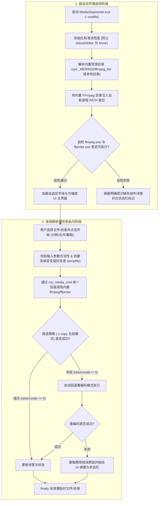

# Windows 沙盒及全新 Windows 环境兼容与健壮性优化方案

## 一、背景与痛点分析

当前 `MediaSegmenter`（音视频处理工具）在开发机上可以运行，但在 **Windows 沙盒（Windows Sandbox）** 或 **全新安装的纯净 Windows 环境** 中运行时存在多处致命 Bug 与兼容性缺陷，导致无法做到“开箱即用”。

经全面排查代码（`main.py`、`build.py`、`build.ps1`）与构建环境，定位核心根因如下：

1. **【致命】外部二进制依赖缺失（FFmpeg / FFprobe 及伴随 DLL 未内置）**：
   - `main.py` 中所有命令调用均硬编码为 `'ffmpeg'` 和 `'ffprobe'`，完全依赖宿主机的 `PATH` 系统环境变量。
   - 全新 Windows 或 Windows 沙盒环境默认未安装 FFmpeg，调用时直接触发 `FileNotFoundError: [WinError 2] 系统找不到指定的文件`。
   - 此外，宿主机的 FFmpeg 为 `gpl-shared` 动态链接构建版本（位于 `C:\sofware\ffmpeg\ffmpeg-master-latest-win64-gpl-shared\bin`），`ffmpeg.exe`（431KB）与 `ffprobe.exe`（221KB）强依赖于同目录下的 8 个核心动态链接库（`avcodec-61.dll`、`avdevice-61.dll`、`avfilter-10.dll`、`avformat-61.dll`、`avutil-59.dll`、`postproc-58.dll`、`swresample-5.dll`、`swscale-8.dll`）。若未将可执行文件及其伴随 DLL 完整打包进 PyInstaller `--onefile` 镜像并在运行时正确注入进程环境，在沙盒中会触发 `0xC0000135 (STATUS_DLL_NOT_FOUND)` 崩溃。

2. **【高危】无控制台（`--windowed`）模式下的输出崩溃与编码异常**：
   - 使用 PyInstaller `--windowed`（无控制台窗口）打包时，在 Windows 下 `sys.stdout` 和 `sys.stderr` 可能为 `None`。代码中存在多处 `print(result.stderr)`，当发生异常或重编码回退时，调用 `print()` 写入 `None` 流或无效句柄会导致线程二次崩溃。
   - `subprocess.run` 硬编码 `encoding='utf-8'` 但未指定 `errors='replace'`，当 Windows 子进程输出包含本地 ANSI（如 GBK）错误消息或特殊路径字节时，会抛出 `UnicodeDecodeError`。
   - `subprocess.run` 未显式传入 `stdin=subprocess.DEVNULL`，在无控制台的 GUI 沙盒进程中，FFmpeg 默认尝试监听标准输入（如响应 `q` 键退出），在某些沙盒句柄环境下会导致子进程挂起或异常退出（需增加 `-nostdin` 或 `stdin=subprocess.DEVNULL`）。

3. **【高危】合并功能（`concat`）特殊文件名报错、未校验返回值与临时文件残留**：
   - `merge_audio` 与 `merge_video` 生成 `concat_list.txt` 时直接拼接 `file '{filename}'`。若文件名含单引号 `'`、空格或特殊字符，FFmpeg `concat` 分离器会解析失败。
   - `merge_audio` 的安全合并模式（`safe_mode`）在循环调用 FFmpeg 转码为 WAV 时**未检查 `result.returncode`**，一旦某个文件转码失败，后续合并直接报错或产出损坏文件。
   - 普通合并模式在用户源文件夹下直接写入 `concat_list.txt`，且未使用 `try...finally` 块清理；一旦合并报错抛出异常，`concat_list.txt` 永久残留在用户的媒体文件夹中。若源文件夹权限受限，还会因无法写入临时文件而失败。

4. **【中危】音频分割强制重编码为 MP3，丢失原格式且效率低**：
   - `process_audio` 将所有输出文件硬编码为 `{base_name}_part{i:02d}.mp3` 并每次执行全量重编码，不仅速度慢、有损音质，而且与输入格式（如 `.wav`、`.m4a`、`.flac` 等）不一致。应与视频分割对齐：保持源扩展名，优先尝试 `-c copy` 无损分割，失败时自动回退重编码（若原容器不支持重编码默认参数，再兜底为 `.mp3`）。

5. **【中危】Windows 沙盒 / 高 DPI 显示与交互体验缺陷**：
   - 窗口尺寸写死为 `600x680` 且 `self.resizable(False, False)`，在 Windows 沙盒小分辨率窗口或高 DPI 缩放（125%/150%）下，底部的进度条和状态栏可能被截断无法看到，用户无法拉伸窗口。
   - 全篇硬编码字体 `"Microsoft YaHei UI"`，在英文版 Windows 沙盒或缺失该字体的精简 Windows 环境中缺乏安全字体回退策略。
   - 当执行失败时，弹窗仅显示笼统的 `"处理过程中发生错误，请查看提示"`，而状态栏仅有一行简短文字且過长文本会被截断，用户无法获知真实的错误原因。
   - 未选择文件时点击“打开输出目录”，`target` 回退为 `"."`，在单文件 EXE 模式下可能打开意外的工作目录，且 `os.startfile` 缺少异常保护。

---

## 二、核心设计规则与技术方案

### 2.1 架构与执行流程图



### 2.2 模块详细设计

#### 1. FFmpeg 与 FFprobe 全内置单文件打包机制（方式 A + 选项 1）
- **运行时路径解析函数 `get_binary_path(bin_name)`**：
  - 优先检查 PyInstaller 单文件解压临时目录：`os.path.join( getattr(sys, '_MEIPASS', ''), 'ffmpeg_bin', f'{bin_name}.exe' )`；
  - 其次检查程序所在目录及子目录：`os.path.join(app_dir, 'ffmpeg_bin', f'{bin_name}.exe')` 和 `os.path.join(app_dir, f'{bin_name}.exe')`；
  - 最后回退 `shutil.which(bin_name)` 查找系统 `PATH`。
  - **重要原则**：在 `run_cmd` 中，直接将命令首项替换为 `get_binary_path` 解析出的绝对路径执行，绝不单凭环境变量查找，彻底杜绝外部同名程序劫持。
- **DLL 搜索路径注入**：
  - 程序启动时，若检测到内置 `ffmpeg_bin` 目录存在，立即将其加入 `os.environ["PATH"]` 的最前面，并在 Python 3.8+ 下调用 `os.add_dll_directory(ffmpeg_bin_dir)`，确保 `ffmpeg.exe` 与 `ffprobe.exe` 能 100% 加载同目录下的 `avcodec-*.dll` 等动态库，不与宿主机环境产生冲突。
- **打包体积与冷启动性能权衡**：
  - FFmpeg 动态库总计约 150MB，PyInstaller `--onefile` 打包后约为 50~70MB。在沙盒或全新系统中每次冷启动，PyInstaller 会在后台自动解压至 `%TEMP%\_MEIxxxxxx`，存在约 1~2 秒的轻微解压耗时，此为单文件免安装便携版之合理预期。
- **构建脚本 `build.py` 与 `build.ps1` 升级**：
  - `build.py` 实现多级自适应探测宿主机 FFmpeg：
    1. 优先读取系统环境变量 `FFMPEG_PATH` 或 `FFMPEG_HOME`；
    2. 其次通过 `shutil.which('ffmpeg')` 自动推导所在目录；
    3. 最后回退备选路径 `C:\sofware\ffmpeg\ffmpeg-master-latest-win64-gpl-shared\bin` 与 `C:\sofware\ffmpeg\ffmpeg-7.1.1-full_build\bin`。
  - 自动提取目录下的 `ffmpeg.exe`、`ffprobe.exe` 以及同目录下所有伴随 `*.dll`（排除无需使用的 `ffplay.exe` 以节省约 12.6MB 体积），通过 PyInstaller 的 `--add-binary "<文件路径>;ffmpeg_bin"` 参数全部打包进单个 `dist/MediaSegmenter.exe` 中。
  - 若构建环境缺少 `ffmpeg.exe` 或 `ffprobe.exe`，构建脚本立即报错终止并提示，杜绝打出残缺 EXE。

#### 2. 子进程安全调用封装 `run_cmd(cmd, cwd=None)`
- 统一封装所有对 `ffmpeg` / `ffprobe` 的调用：
  - 自动将命令首项 `'ffmpeg'` / `'ffprobe'` 替换为 `get_binary_path` 解析出的绝对路径；
  - 对 `ffmpeg` 命令自动注入 `-nostdin` 参数（或统一设置 `stdin=subprocess.DEVNULL`），防止后台无控制台进程等待标准输入挂起；
  - 统一配置 `stdout=subprocess.PIPE, stderr=subprocess.PIPE, stdin=subprocess.DEVNULL, creationflags=CREATE_NO_WINDOW, text=True, encoding='utf-8', errors='replace'`，彻底杜绝 `UnicodeDecodeError`；
  - 移除裸 `print(result.stderr)`，改为安全日志记录函数 `safe_log()`（仅在 `sys.stderr` 可写时输出），并在命令失败时截取 `stderr` 末尾的关键错误行包含在异常信息中，方便用户在弹窗中直接看到具体失败原因。

#### 3. 音频分割（`process_audio`）升级为“原格式优先无损 + 自动回退重编码”
- 获取输入音频文件的原始扩展名 `ext`（若无扩展名或非常规容器则默认 `.mp3`）：
  - 输出文件名改为 `{base_name}_part{i:02d}{ext}`；
  - 第一步尝试无损快速分割：`ffmpeg -nostdin -y -ss {start_time} -i {input_file} -t {segment_duration} -c copy -avoid_negative_ts make_zero {output_file}`；
  - 若返回码非 0（或生成的输出文件大小为 0），状态栏提示 `"第 {i} 段无损分割失败，正在重新编码..."`，并自动回退为重编码模式：`ffmpeg -nostdin -y -ss {start_time} -i {input_file} -t {segment_duration} {output_file}`；
  - 若原扩展名容器在重编码时仍失败，最终兜底输出为 `.mp3` 格式重编码。

#### 4. 音视频合并（`merge_audio` / `merge_video`）健壮性重构
- **安全临时目录**：
  - 使用 `tempfile.mkdtemp(prefix="media_seg_merge_")` 在系统临时目录创建独立工作区，不再污染用户的源媒体文件夹，也避免源文件夹只读权限问题；
  - 全程包裹在 `try...finally` 中，无论成功或失败均确保 `shutil.rmtree(temp_dir, ignore_errors=True)` 清理干净，绝不残留 `concat_list.txt` 或临时 `.wav` 文件。
- **FFmpeg Concat 路径安全转义**：
  - 生成 `concat_list.txt` 时，使用文件的规范绝对路径，将反斜杠统一转换为正斜杠，并将单引号转义为 `'\''`，格式为：
    ```python
    safe_path = os.path.abspath(filepath).replace('\\', '/').replace("'", "'\\''")
    f.write(f"file '{safe_path}'\n")
    ```
    彻底解决中文名、空格、单引号及跨目录调用问题。
- **安全合并模式（`safe_mode`）严格返回值校验**：
  - 在 `merge_audio` 的 `safe_mode` 循环转码阶段，每次调用 `run_cmd` 后严格检查 `returncode != 0`，一旦任一文件转码失败立即抛出含文件名的明确异常，不再静默忽略。

#### 5. Windows 沙盒环境 UI 适配与异常反馈优化
- **窗口与高 DPI 适配**：
  - 将 `self.resizable(False, False)` 改为 `self.resizable(True, True)`，并设置 `self.minsize(580, 620)`，允许在不同分辨率和 DPI 缩放比例的 Windows 沙盒中自由调整窗口大小，防止底部控件被遮挡。
- **跨语言系统字体安全回退**：
  - 启动时通过 `tkinter.font.families()` 检测当前系统可用字体：优先使用 `"Microsoft YaHei UI"`，若不存在则依次回退 `"Microsoft YaHei"` -> `"SimHei"` -> `"Segoe UI"` -> `"Arial"`。将其统一定义为全局常量 `FONT_FAMILY`，全面替换代码中硬编码的 60 余处字体字符串，保证在中英文纯净 Windows 沙盒中界面排版均正常。
- **启动自检与详细错误弹窗**：
  - 软件启动后自动校验内置 `ffmpeg` / `ffprobe` 是否可用，若异常则第一时间在界面状态栏及弹窗提示。
  - 各任务完成回调 `on_*_complete(self, success, error_msg="")` 支持传递具体错误摘要，失败时 `messagebox.showerror` 直接展示详细错误原因（如“无法获取媒体时长”、“输入文件夹无有效文件”或 FFmpeg 具体报错摘要），不再只显示无意义的“请查看提示”。
- **打开目录安全防护**：
  - 点击“打开输出目录”时，若尚未选择文件且无有效输出目录，直接友好提示“请先选择媒体文件”，不再默认打开 `"."`；并用 `try...except` 包裹 `os.startfile`，防止异常崩溃。

---

## 三、变更文件清单

| 文件路径 | 变更类型 | 变更说明 |
| :--- | :--- | :--- |
| `main.py` | 修改 | 1. 新增内置 `ffmpeg`/`ffprobe` 路径解析、DLL 目录注入与启动自检；<br>2. 新增 `run_cmd` 子进程安全调用封装（`-nostdin`、`errors='replace'`、无控制台流保护）；<br>3. 升级 `process_audio` 为保持原扩展名优先无损分割、失败自动重编码；<br>4. 重构 `merge_audio` / `merge_video` 使用系统临时目录、路径单引号转义、`try...finally` 清理及 `safe_mode` 返回码检查；<br>5. 优化 UI 可缩放窗口、字体回退、详细错误弹窗及打开目录安全校验。 |
| `build.py` | 修改 | 自动检索本地 FFmpeg 目录下的 `ffmpeg.exe`、`ffprobe.exe` 及伴随 `*.dll`，通过 `--add-binary` 打包进 `--onefile` 单文件 EXE，并校验打包产物完整性。 |
| `build.ps1` | 修改 | 同步更新清理与调用 `python build.py` 构建流程，增加构建后结果校验提示。 |
| `README.md` | 修改 | 更新构建说明、音频无损分割特性说明及免安装开箱即用说明。 |

---

## 四、异常与风控机制

1. **无控制台句柄保护**：在程序入口处检查 `sys.stdout` 和 `sys.stderr`，若为 `None`（`--windowed` 模式），自动重定向至 `os.devnull`，彻底避免任何第三方库或内部代码写标准输出引发 `AttributeError: 'NoneType' object has no attribute 'write'`。
2. **输出文件有效性校验**：分割、合并、截取生成目标文件后，额外检查 `os.path.exists(output_file) and os.path.getsize(output_file) > 0`，防止 FFmpeg 返回 0 但产出 0 字节空文件被误判为成功。
3. **重名文件自吞噬防护**：合并文件时，使用 `os.path.normcase(os.path.abspath(...))` 精确过滤掉输出文件本身，防止大小写差异导致把旧输出文件再次合并进去。

---

## 五、验收标准 (Acceptance Criteria)

开发完成后，必须逐项执行以下客观核验清单，**100% 全部通过**方可交付结项：

### AC-1：内置 FFmpeg / FFprobe 单文件打包与零依赖隔离验证（正向 & 环境隔离）
- **验证方法**：
  1. 执行 `python build.py` 生成单文件 `dist/MediaSegmenter.exe`；
  2. 在清空了系统 `PATH`（即 `PATH` 中仅保留 `C:\Windows\System32`，完全移除开发机原有的 `C:\sofware\ffmpeg\...` 路径）的隔离环境/沙盒进程中，验证内置路径解析与 `ffmpeg` / `ffprobe` 调用；
- **通过标准**：
  - `dist/MediaSegmenter.exe` 成功生成，且 PyInstaller 构建包内完整包含 `ffmpeg_bin/ffmpeg.exe`、`ffmpeg_bin/ffprobe.exe` 及 8 个伴随 `.dll`；
  - 在清空 FFmpeg `PATH` 的纯净环境变量下，程序能成功解析到内置的 `ffmpeg.exe` 和 `ffprobe.exe` 并正常执行版本自检与媒体探针，返回码为 `0`，不报找不到文件或缺失 DLL 错误。

### AC-2：音频处理全功能验证（音频分割、音频合并、安全合并、音频截取）
- **验证方法**：
  1. **音频分割（原格式无损优先）**：对测试音频（如 `.wav` 和 `.mp3`）执行 3 段分割、重叠 1 秒；
  2. **音频合并（含特殊字符文件名）**：将含有空格、中文及单引号 `'` 的多个音频片段进行普通合并与安全合并（`safe_mode=True`）；
  3. **音频截取**：对测试音频截取 `1.00` 秒至 `3.50` 秒区间（同时测试 `00:00:01.00` 时分秒格式）。
- **通过标准**：
  - 音频分割产出 3 个对应原扩展名的片段文件，文件大小均 `> 0`，时长与数学计算值 `(duration / num_parts) + overlap` 误差在 `±0.2s` 以内；
  - 普通合并与安全合并均成功产出目标音频文件，且源文件夹下**无任何残留**的 `concat_list.txt` 或 `temp_safe_merge` 文件夹；
  - 音频截取成功产出 `*_clip_1.00_3.50.*` 文件，时长约为 `2.5s`（误差 `±0.2s`）。

### AC-3：视频处理全功能验证（视频分割、视频合并、视频截取）
- **验证方法**：
  1. **视频信息读取**：调用 `get_video_info` 读取测试视频（`.mp4`），校验返回的时长、宽高分辨率、文件大小；
  2. **视频分割**：对测试视频执行 2 段分割、重叠 1 秒；
  3. **视频合并**：将分割后的视频片段（含中文/特殊字符路径）合并为单个视频；
  4. **视频截取**：截取指定时间段视频。
- **通过标准**：
  - `get_video_info` 准确返回浮点数时长、整数宽高（如 `320x240`）和字节数；
  - 视频分割、视频合并、视频截取均 100% 成功生成非空有效视频文件，且可通过 `ffprobe` 正常读取生成的视频流信息，源目录下无 `concat_list.txt` 残留。

### AC-4：异常与逆向边界分支验证
- **验证方法**：
  1. 传入不存在或损坏的媒体文件调用处理函数；
  2. 对空文件夹执行音频/视频合并；
  3. 验证 `parse_time_input` 对合法格式（`"37.30"`, `"01:05.5"`, `"00:01:05.50"`）与非法格式（`"abc"`, `"1:2:3:4"`）的解析表现。
- **通过标准**：
  - 损坏文件或空文件夹处理时，`complete_callback` 接收到 `False` 且收到包含具体原因的 `error_msg`，程序不崩溃、不抛出未捕获异常，临时目录 100% 被清理；
  - `parse_time_input` 正向计算精度完全匹配，非法输入准确抛出 `ValueError`。

### AC-5：GUI 界面启动与打包产物端到端验证
- **验证方法**：
  1. 启动打包后的 `dist/MediaSegmenter.exe`（在清空外部 FFmpeg `PATH` 的环境下），验证窗口正常渲染、无闪退、无弹窗报错；
  2. 检查窗口最小尺寸限制、可缩放属性、字体回退机制及各 Tab 页切换。
- **通过标准**：
  - `dist/MediaSegmenter.exe` 独立进程正常启动并渲染主窗口，进程存活无崩溃退出。
